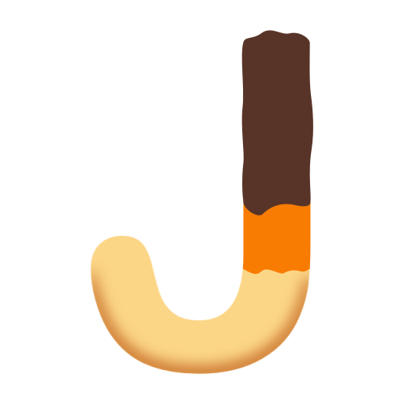

<p align="center">
  
</p>

<h1 align="center">Jafa</h1>

<p align="center">
  A CLI tool making Roblox repositories – simpler
</p>

---

Jafa is a CLI tool for managing Roblox monorepos. It scaffolds a shared workspace integrating popular tools (Rojo, Wally, Rokit, Selene, StyLua) and lets you spin up new projects inside it with a consistent folder structure, so multiple Roblox experiences can live side by side in one repository - or share resources!

It's a single native binary written in Rust, so there's no Node.js to install.

## Installation

Download the archive for your platform from the [latest release](https://github.com/Blaadam/jafa/releases/latest), extract it, and put `jafa` on your `PATH`.

Or, with [Rust](https://www.rust-lang.org/tools/install) installed:

```sh
cargo install jafa
```

Jafa also needs [Rokit](https://github.com/rojo-rbx/rokit) and Git on your `PATH`. It runs `rokit install` for you, which installs Rojo, Wally, StyLua, Lune, Mantle, Selene and wally-package-types.

Check it worked:

```sh
jafa --version
```

## Quick start

```sh
jafa init my-game       # asks for a first project name and which tools to run
cd my-game
jafa new my-experience  # add another project
jafa dev my-experience  # build, open in Roblox Studio, and serve for live sync
```

To skip the questions: `jafa init my-game --yes --name lobby`.

## Usage

```sh
jafa <command> [options]
```

### Commands

| Command | Description |
| --- | --- |
| `init [target-directory] [-y] [-n name] [--common]` | Create a new Jafa workspace in the given directory (defaults to the current directory). |
| `new <project-name> [target-directory]` | Create a new project inside an existing Jafa workspace. |
| `build <project-name>\|-a\|--all [target-directory]` | Build a project (or every project) with Rojo, writing to `artifacts/`. |
| `open <project-name>\|-a\|--all [target-directory]` | Open a project's built `.rbxl` file (or every built project) in Roblox Studio. |
| `serve <project-name> [target-directory]` | Serve a project for live-sync with Roblox Studio via `rojo serve`. |
| `dev <project-name> [target-directory]` | Build, open, and serve a project, in order. |
| `deploy <project-name>\|-a\|--all [target-directory] [-e env] [-g groupid] [-p payments] [-n name]` | Build a project and deploy it to Roblox using Mantle, as its own experience. |
| `new-universe <universe-name> [projects...] [-e env]` | Create a starter Mantle config for one experience made of several projects. |
| `deploy-universe <universe-name> [-e env]` | Build the projects a universe uses, then deploy it with Mantle. |
| `sourcemap <project-name>\|-a\|--all [target-directory]` | Generate a `sourcemap.json` for a project (or every project). |
| `pull <project-name>\|-a\|--all [target-directory]` | Pull published Roblox assets (terrain, maps, lighting, etc.) into a project (or every project), as described by its `.jafa` file. |

`build`, `open`, `deploy`, `sourcemap`, and `pull` accept `-a`/`--all` to run against every project under `projects/` instead of a single named one. Run `jafa --help` or `jafa <command> --help` for every option.

### Examples

```sh
jafa init my-game --common
jafa new my-experience
jafa dev my-experience
jafa build --all
jafa deploy my-experience -e prod -g 35171099 -p group
jafa new-universe my-game lobby tennis bowling
jafa deploy-universe my-game -e stg
jafa pull my-experience
```

## What `init` creates

Running `jafa init` scaffolds a workspace with:

- `rokit.toml`, `wally/wally.toml` for tool and package management
- `jafa.code-workspace`, `.vscode/`, `.gitignore`, `README.md`
- `asset-updater.luau`, the Lune script `jafa pull` uses to pull published
  Roblox assets into a project
- A git repository (if one doesn't already exist), tools installed via `rokit install`, and Wally packages installed via `wally install --project-path ./wally`. Jafa asks before running each of these.
- A `projects/` directory containing your first project (see below — this is where per-project files like `default.project.json`, `selene.toml`, and `stylua.toml` live), and a shared `common` project if you asked for one

## What `new` creates

Running `jafa new <project-name>` adds a new project under `projects/<project-name>`,
scaffolded with client/server/shared/UI folder structure (services, controllers,
modules, databases, components, etc.), a `.jafa` asset manifest used by `jafa pull`,
and a Rojo project tree wired up to `ReplicatedStorage`, `ServerScriptService`,
and `Workspace`. The project is also added to `jafa.code-workspace`.

## The common project

A project named `common` holds code shared between your other projects. Create it with `jafa init --common` or `jafa new common`. Every project made after it is linked to it in its Rojo tree, so shared code shows up beside each project's own.

## Universes

An experience can have several places, such as a lobby plus one for each game mode. `jafa new-universe` writes a starter Mantle config with a place for each project, and `jafa deploy-universe` builds the projects it uses and deploys them. You edit the config, and Jafa never rewrites it. Use `jafa deploy` instead to put a single project somewhere you can test it on its own.

## Documentation

Full docs, including per-command reference and workspace/project concepts, are at [jafa.adwo.dev](https://jafa.adwo.dev). To serve them locally, run `npm install` then `npm start` in `website/`.

## Roadmap

- [x] `init` — create a Jafa workspace
- [x] `new` — create a new project (resource)
- [x] `build` — compile a project
- [x] `open` — open a project
- [x] `serve` — serve a project
- [x] `dev` — build, open, and serve a project (in order)
- [x] `deploy` — build and deploy a project to Roblox using Mantle
- [x] `new-universe` / `deploy-universe` — deploy several projects as one experience
- [x] `sourcemap` — generate a sourcemap for a project
- [x] `pull` — pull published Roblox assets into a project

## Development

The tool lives in [`tool/`](tool/) and needs Rust 1.88 or newer.

```sh
cd tool
cargo build
cargo test
cargo clippy --all-targets
```

To try your build as `jafa` in your own workspace, run `cargo install --path tool --debug` from the repo root.

Releases are built by GitHub Actions: pushing a tag like `v2.0.0` (matching the version in `tool/Cargo.toml`) builds binaries for Windows, macOS and Linux and publishes them as a GitHub release.
